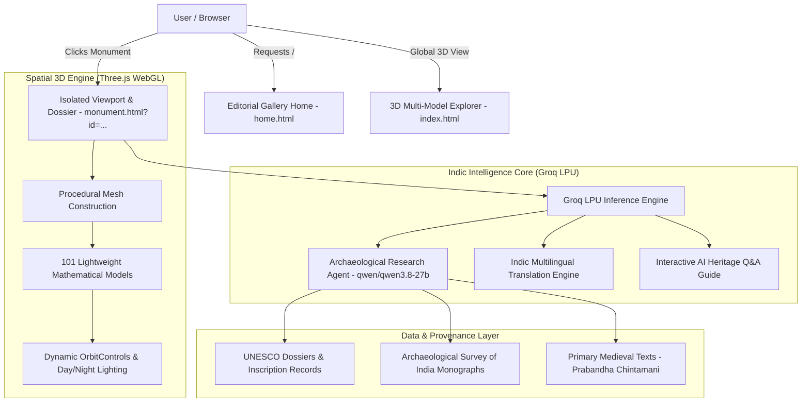

<div align="center">

# 🏛️ pastIQ (पास्टआईक्यू)
### *Unlocking 5,000 Years of Indian Monumental Heritage Through Spatial 3D & Indic AI Intelligence*

[](https://github.com/2007dhruv/pastIQ)
[](https://threejs.org/)
[](https://groq.com/)
[](#-indic-multilingual-bridge)
[](LICENSE)

<br/>

<a href="https://git.io/typing-svg">
  
</a>

<br/>

[🏛️ Explore 3D Gallery](#-core-features) • [🤖 AI Heritage Agent](#-autonomous-ai-heritage-agent) • [🌐 Indic Languages](#-indic-multilingual-bridge) • [⚡ Quickstart](#-getting-started) • [📑 Provenance & Citations](#-epigraphic-provenance--citations)

</div>

---

## 📖 Executive Summary

**pastIQ** (*Past + Intelligence*) is a next-generation cultural preservation platform built for **Blithchron '27 (IIT Gandhinagar)**. 

While existing digital tourism relies on flat Wikipedia paragraphs or bloated 50MB+ 3D scans that crash mobile browsers, **pastIQ** takes an entirely novel computational approach:
- **101 Procedural 3D Monuments** engineered purely with mathematical Three.js geometry — loading in milliseconds at less than **10 KB per model** with zero 3D file downloads.
- **Autonomous Epigraphy & Research Agent** accelerated by **Groq's LPU inference engine**, delivering sub-second historical analysis, forgotten folklore, and verified citations from **UNESCO dossiers**, **ASI monographs**, and **medieval Sanskrit chronicles**.
- **Indic Multilingual Engine** bridging the digital divide by translating architectural monographs into **10 Indian regional languages** in real time.

---

## 🏛️ Architectural Heritage Gallery

<div align="center">
<table>
  <tr>
    <td width="50%" align="center">
      
      <br/><b>Rani ki Vav (રાણકી વાવ)</b><br/><i>Patan, Gujarat · 11th Century Solanki Subterranean Temple</i>
    </td>
    <td width="50%" align="center">
      
      <br/><b>Taj Mahal (ताज महल)</b><br/><i>Agra, UP · 1632 CE Indo-Islamic Marble Marvel</i>
    </td>
  </tr>
  <tr>
    <td width="50%" align="center">
      
      <br/><b>Sun Temple (सूर्य मन्दिर)</b><br/><i>Konark, Odisha · 1250 CE Kalinga Celestial Chariot</i>
    </td>
    <td width="50%" align="center">
      
      <br/><b>Vittala Temple (विट्ठल मन्दिर)</b><br/><i>Hampi, Karnataka · Vijayanagara Monolithic Chariot</i>
    </td>
  </tr>
</table>
</div>

---

## ⚡ System Architecture



---

## 🌟 Core Pillars

### 1. 📐 Procedural 3D WebGL Engine
- **Zero Heavy Downloads:** Built entirely in code from primitive geometric shapes and mathematical extrusions.
- **Ultra-Lightweight:** Loads in under **0.5 seconds** on any 4G/5G mobile browser (~2 KB per monument).
- **Interactive Orbit Camera:** Complete 360° rotation, pitch, and zoom exploration.
- **Day & Night Simulation:** Real-time atmospheric shader with solar angles, stars, and architectural night floodlights.

### 2. 🤖 Autonomous AI Heritage Agent
- **Powered by:** Groq LPU with ultra-low latency response times (~500 tokens/sec).
- **Deep Inscription Analysis:** Discovers historical epigraphs, stone edicts, architectural secrets, and forgotten folklore.
- **Verified Source Tracking:** Automatically extracts academic citations, UNESCO nomination numbers, and ASI conservation papers.

### 3. 🌐 Indic Multilingual Bridge
Heritage belongs to every citizen in their native tongue. pastIQ provides real-time AI translation across **10 regional Indian languages**:

| Language | Native Script | Coverage |
|---|---|---|
| **English** | English | Universal International |
| **Gujarati** | ગુજરાતી | Regional Host Language (IIT Gandhinagar) |
| **Hindi** | हिन्दी | National Devanagari |
| **Tamil** | தமிழ் | Dravidian Classical |
| **Telugu** | తెలుగు | Andhra & Telangana Classical |
| **Marathi** | मराठी | Western Deccan Heritage |
| **Bengali** | বাংলা | Eastern Cultural Heritage |
| **Kannada** | ಕನ್ನಡ | Vijayanagara & Hoysala Heritage |
| **Punjabi** | ਪੰਜਾਬੀ | Northern Heritage & Sacred Shrines |

---

## 📑 Epigraphic Provenance & Citations

Every monument dossier in **pastIQ** is cross-referenced with primary historical and academic records:

```
├── 📄 UNESCO World Heritage Nomination Dossiers (Ref: 922, 252, etc.)
├── 🏛️ Archaeological Survey of India (ASI) Vadodara, Agra & Southern Circles
├── 📜 Prabandha-Chintāmaṇi (1304 CE) by Merutuṅga Āchārya
├── 📚 "The Queen's Stepwell at Patan" by Dr. Kirit Mankodi (Project for Indian Cultural Studies)
└── 📜 Padshahnama (Official Court Records of Emperor Shah Jahan)
```

---

## 🚀 Getting Started

### Prerequisites
- Python 3.8+ (for local HTTP server with correct ES module MIME types)
- Any modern web browser (Chrome, Edge, Firefox, Safari)

### Installation & Launch

1. **Clone the repository:**
   ```bash
   git clone https://github.com/2007dhruv/pastIQ.git
   cd pastIQ
   ```

2. **Start the pastIQ local server:**
   ```bash
   python server.py
   ```

3. **Open in your browser:**
   - **Editorial Homepage:** [http://localhost:8000](http://localhost:8000)
   - **Rani ki Vav AI Dossier & Isolated 3D:** [http://localhost:8000/monument.html?id=rani-ki-vav](http://localhost:8000/monument.html?id=rani-ki-vav)
   - **Global 101 Model Engine:** [http://localhost:8000/index.html](http://localhost:8000/index.html)

---

## 🛠️ Technology Stack

| Component | Technology | Role |
|---|---|---|
| **3D Rendering** | [Three.js r160](https://threejs.org/) | WebGL geometry, OrbitControls, Post-processing |
| **AI Inference** | [Groq LPU](https://groq.com/) | Ultra-low latency LPU execution (`qwen/qwen3.8-27b`) |
| **Frontend** | HTML5, CSS3, ES6 Modules | Modern responsive editorial layout |
| **Typography** | Cinzel, Playfair Display, Rozha One | Authentic museum-grade indic typography |
| **Local Server** | Python `http.server` | Custom MIME-type streaming for ES Modules |

---

## 📜 License & Acknowledgments

- **pastIQ Platform, AI Agents & Editorial UX:** Licensed under the [MIT License](LICENSE).
- **Procedural 3D Geometry:** Adapted from community open-source Three.js landmark models under MIT.
- **Imagery:** Wikimedia Commons & Archaeological Survey of India under Creative Commons / Public Domain.

<div align="center">
  <br/>
  <b>Made with pride for Indian Heritage & Civilizational Preservation 🇮🇳</b>
  <br/><br/>
</div>
